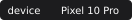
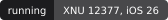
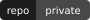

<!-- status:begin -->

<p align="center"></p>

<h2 align="center">A phone that was never meant to do this.</h2>
<p align="center">Apple's open-source kernel. iOS 26's own userland. Google's Tensor G5.<br>Custom drivers, written block by block, for one extraordinary piece of hardware.</p>

<p align="center">      </p>
<p align="center"><a href="#progress">Progress</a> · <a href="#quick-start">Quick start</a> · <a href="#roadmap">Roadmap</a> · <a href="#how-it-boots">How it boots</a> · <a href="#documentation">Docs</a> · <a href="#contributing">Contributing</a> · <a href="#licensing">Licensing</a> · <a href="#credits">Credits</a></p>

<p align="center"></p>

<a id="progress"></a>
<h2 align="center">Every block. Tracked.</h2>
<p align="center"><b>46%</b> across 47 reachable features. Updated 2026-11-02.</p>

<p align="center"></p>

| | Status | Features | Counts as |
| --- | --- | ---: | ---: |
| ✅ | Works on the phone | 12 | 100% |
| 🟡 | Partly working | 12 | 60% |
| 🔧 | Built, not run | 2 | 35% |
| ⏳ | In progress | 9 | 20% |
| ❌ | Not started | 12 | 0% |
| 🚫 | Likely out of reach | 6 | not counted |

<details><summary><b>See every feature</b></summary>

| Block | Feature | Status |
| --- | --- | --- |
| **CPU** | 5 A725 cores | ✅ Ran 15 min under iOS at 1075 MHz, no kernel crash |
|  | CPU clock control | ✅ Governor ran 15 min under iOS: 533–1075 MHz on demand, 125 clock reads within 2%, 33–35 °C |
|  | Higher clocks, up to the 3052 MHz top | 🟡 Short test only: one core, each step under 1 s, 36 °C; the governor stops at 1075 MHz for now |
|  | 2 A520 cores | 🟡 cpu0 parked in the shim; cpu1 unused |
|  | X4 core | 🚫 For now: its errata aren't fixed |
|  | Idle sleep | ✅ By code reading: cores already idle in WFI |
| **Memory** | Memory and shared cluster clocks | ✅ Raised under iOS for 15 min; memory path up to 2.85x in a short test |
|  | RAM | ✅ 12.92 GiB under iOS for 15 min; memory test passed |
|  | The rest of the 16 GiB | ❌ Not assigned |
| **Display** | Full 1280x2856 picture | ✅ Scaled from 1125x2511 |
|  | 120 Hz | 🟡 Panel runs at 120, iOS draws about 20–31 fps; rate switch built, not run |
|  | 60 Hz mode and frame sync | 🔧 Next test |
|  | Variable refresh down to low rates | ❌ Automatic idle rate isn't built |
|  | Brightness | 🟡 Capped at about 140 nits; no user control yet |
|  | HDR, peak brightness, colour calibration | ❌ Not assigned |
|  | Always-on display, self-refresh | ❌ Not assigned |
| **Graphics** | GPU power-on and ID | ✅ GPU answers: core id read from XNU, clean power-off |
|  | GPU firmware through Trusty | 🟡 Physical p29: signed image accepted and firmware started; health completion failed, pending firmware message |
|  | Metal drawing | ⏳ Native GPU rendering incomplete; physical p29 still draws on the CPU |
|  | Video encode and decode | ❌ Not assigned |
| **Storage** | Reading | ✅ Multi-block reads, 0 errors |
|  | Writing (persistent /var) | 🟡 Saves and restore across reset verified; root unchanged; real-setting test pending |
|  | Maximum speed | ⏳ Patches being measured |
| **Input** | Touch | ✅ Home and Settings work physically; owner confirms slow response and heavy lag |
|  | Scripted taps and keys | 🟡 p29 completed 14 token executions and two home returns; push_surface abort absent; separate startup crash remains |
|  | Volume keys | 🟡 Read in a probe |
|  | Power key | ⏳ Retry needs someone at the phone |
|  | Tap to wake, palm rejection | ❌ Not assigned |
| **Connectivity** | Wi-Fi | 🟡 Radio up, join code ready; passive scan heard 25 networks; no join yet |
|  | Bluetooth | 🟡 Firmware running; passive scan heard 51 addresses at 4 Mbaud; not connected to iOS yet |
|  | Cellular | ⏳ Modem identified; first check built |
|  | SIM, eSIM | ⏳ Part of cellular |
|  | GPS | ❌ Not assigned |
|  | NFC | ❌ Reading tags possible at most; Apple Pay is out of reach |
|  | UWB | ❌ Not assigned; presence unconfirmed |
| **USB** | Fastboot and logs | ✅ |
|  | Live console | ✅ Physical p29: 1,533,021 live USB bytes matched RAM dump; 0 mismatches, stalls or restarts |
|  | Link to the Mac | ⏳ mux-1 test in QEMU |
|  | Network over USB | ❌ Not assigned |
|  | USB host, video out | 🚫 No host stack in open XNU |
| **Audio** | Speakers, microphones | ⏳ QEMU test queued; depends on always-on chip |
|  | Haptics | 🟡 Chip found; one effect commanded; felt buzz unconfirmed |
| **Sensors** | Accelerometer, gyro, proximity, light, barometer | ⏳ Physical: accel and gyro samples through 2400, changing orientation; proximity/light/barometer and app integration unproved |
|  | Always-on chip | ⏳ First test built |
| **Power** | Temperature and thermal guard | ✅ Live temperatures; guard panic verified at a test limit |
|  | Battery gauge | 🟡 Kernel reads the real gauge: 89%, 4332 mV; status bar unconfirmed |
|  | Charging control | ❌ Left at the bootloader's settings |
|  | Wireless charging | ❌ Not assigned |
|  | Real date and time | 🔧 Ready to test |
| **Cameras** | Cameras, flash | 🚫 Likely months: sensor details aren't public |
| **Security** | Fingerprint, Face ID | 🚫 Tied to Apple's security chip |
|  | Secure enclave | 🚫 Stand-ins only, so the passcode doesn't encrypt anything |
| **Apple services** | Activation, iMessage, App Store purchases | 🚫 Need a real iPhone's identity |

</details>

<sub>Percentages are a progress estimate from the table above, not a benchmark. Measured figures come from single test boots of one phone, and their notes say which were short tests or estimates. Rebuild with `python3 -I tools/readme_status.py` after editing `docs/status.json`.</sub>

> **What this is.** An experimental research bring-up on the owner's own phone, not a usable phone OS and not a product. Nothing here is for sale. It isn't affiliated with or endorsed by Apple or Google. No Apple software or firmware is distributed here. Apple's security model is largely switched off, so the phone isn't safe for real data.

<!-- status:end -->

---

## Quick start

Everything here runs on a clean clone and never touches a phone:

```sh
git clone https://github.com/TheAndersMadsen/ios-on-pixel-10.git && cd ios-on-pixel-10
.github/scripts/check_tracked.py      # no dumps, firmware, Apple files or identifiers
.github/scripts/ci-tests.sh           # what CI runs: host tests and a README freshness check
python3 -I tools/readme_status.py     # rebuild the README's status and images from docs/status.json
```

Python 3.12 or newer and a C compiler at `/usr/bin/cc`.

A phone image is a different matter. It needs inputs that are never committed, such as Apple artifacts, the kernel series and the phone's own device tree, so **a clean clone can't build one.** [docs/BUILD.md](docs/BUILD.md) lists each input and its pinned hash, then the build and boot commands. Read [CONTRIBUTING.md](CONTRIBUTING.md) before any boot.

## Roadmap

Generated from `docs/status.json`. Order can change with each physical result.

<!-- roadmap:begin -->

**Now**

- Stop the compositor crash on the home key: a fix that tracks its surfaces is built, not run
- Read the GPU's ID, now that the power firmware reports its domain on
- Wi-Fi: load the regulatory data, then scan and join from the kernel
- Motion data: a stream from the chip that answered, then the other sensors on that bus
- Settings' text and colours on the phone: they draw in QEMU

**Next**

- Persistent /var: the first write to free blocks, after the owner's approval
- Volume and power keys into iOS, display off and wake
- Battery percentage from the real gauge, real date and time
- Live USB console, then the link to the Mac
- Brightness control, 60 Hz and frame sync, and the clock governor on every boot

**Later**

- GPU firmware through Trusty, then Metal: months away
- Audio and haptics
- All RAM to 12.92 GiB and past it
- Bluetooth, cellular, GPS
- Sleep and standby

**Likely out of reach**

- X4 core, USB host, video out, Cameras, flash, Fingerprint, Face ID, Secure enclave, Activation, iMessage, App Store purchases

<!-- roadmap:end -->

<!--
Screenshots: intentionally empty. Frames of iOS show Apple's UI, which is Apple's copyright, so none are committed.
Add one here only if the owner provides it or it is a QEMU frame, and only after checking it holds no Apple UI,
serial number, IMEI, MAC address or account name.
-->

## How it boots

This project ports Apple's open-source XNU kernel to the Pixel 10 Pro (`laguna`, board `blazer`, Tensor G5), running XNU 12377 and the iOS 26 userland. Boots are temporary RAM boots through `fastboot boot`; the boot tool leaves `force-fastboot` on. The root image is on `userdata_exp.ai`.

```
ABL (stock Google bootloader, unlocked)
  -> fastboot boot <image>                    (temporary; nothing is flashed to boot)
     -> shim: own MMU setup, reads the live FDT, loads the payload
        -> XNU Mach-O + generated Apple Device Tree (ADT) + boot-args
           -> XNU -> small ramdisk, then mounts the UFS root in userdata_exp.ai
              -> dyld + shared cache -> launchd -> daemons -> UI
```

There is no serial console. The diagnostics live in reserved RAM at `0x95200000` and are read from fastboot after the phone returns there.

## Repository layout

| Path | What |
| --- | --- |
| `AGENTS.md` | How to work on this repository |
| `HANDOFF.md` | Latest state and next step, newest first |
| `NOTES.md` | Goal, hardware facts, artifact locations and dated working notes |
| `BLAZER.md` | Pixel 10 Pro bring-up status and evidence history |
| `docs/` | Build guide, licensing, status data and README images |
| `shim/` | Boot shim |
| `tools/` | Build, boot and log tools |
| `xnu/` | Build notes; `ios16-base/patches` is the parts source for the 12377 port |
| `.github/` | CI, the check on tracked files, and issue and pull request templates |
| `backup/` | Stock boot images; not committed |
| `research/` | Evidence, sources, the iOS 26 kernel series and earlier documents; not committed |

## Key hardware facts

- SoC Tensor G5 (`google,lga-blazer`). Boot-state truth is in `/proc/bootconfig` (`device_state=unlocked`), not `getprop`.
- UFS: Samsung KLUDG4UHGC (128 GB), host controller at `0x3c400000`.
- USB: DWC3 at `0x0c400000`, wrapper at `0x0c450000`.
- Log RAM: ramoops at `0x95200000`, pmsg at `0x95400000`.

More in [`NOTES.md`](NOTES.md).

## Documentation

Start at [docs/README.md](docs/README.md). Changes and results by date are in [CHANGELOG.md](CHANGELOG.md).

## Contributing

[CONTRIBUTING.md](CONTRIBUTING.md) covers how boots are run and what must never be committed. Conduct: [CODE_OF_CONDUCT.md](CODE_OF_CONDUCT.md). Security: [SECURITY.md](SECURITY.md).

## Licensing

**This repository is private and no licence is granted.** It holds code from several origins, some with no licence at all, so there is no `LICENSE` file. [docs/LICENSING.md](docs/LICENSING.md) says which paths are what, and what must be audited before any public release.

## Credits

This work stands on other people's, and listing a project here doesn't mean it endorses this one.

- **Apple:** the XNU open-source releases, and dyld's during the iOS 16 work. The iOS userland is proprietary and stays out of this repository.
- **[ios-tegu](https://github.com/dgigantino/ios-tegu):** the base of the local iOS 26 kernel series, and the origin of the shim's EL2 to EL1 entry sequence, payload format and USB diagnostic protocol. It has no licence, which is the main reason this one can't go public as it stands.
- **HakiOS** (`oosexgang/hackios-xnu-kernel`, `hackios-xnu-userland`): upstream porting base, in the iOS 16 patches and tools.
- **dada:** a parts source for the local kernel series, which isn't tracked here.
- **felix:** the loader work behind a pinned local copy of `avbtool`, and the shim's panic screen style.
- **Google and the Android Open Source Project:** `tools/mkbootimg.py` (Apache-2.0), and Pixel kernel sources.
- **GrapheneOS** kernel trees and **Linux:** vendor sources read for hardware facts and used to generate tables in `shim/`; `shim/tgl_ufs_link.c` carries Linux and Google's UFS code under GPL-2.0-only.

Origins, per path: [docs/LICENSING.md](docs/LICENSING.md).
